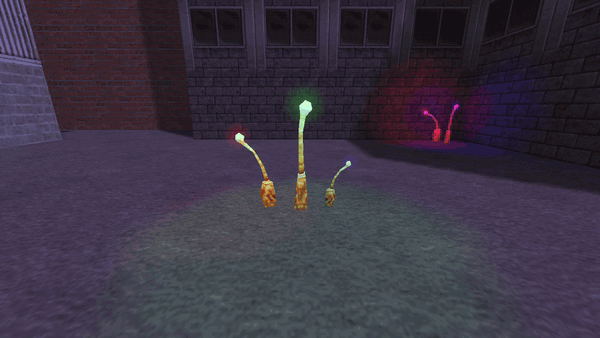

<h1 align="center">Xen Light</h1>

<p align="center">
  
</p>

## 📝 Description
This plugin adds a fully dynamic Xen light system to Counter-Strike 1.6.
Lights can be placed, managed and configured during gameplay with runtime control over visibility, team access, activation states and glow effects.
- Create and remove Xen lights during gameplay via an in-game menu
- Multiple light sizes with individual models and configurable collision bounds
- Configurable per light: solidity, team access, animation speed and spawn chance
- Delayed and timed activation with random ranges for round-based gameplay
- Dynamic light rotation and natural ghost preview placement
- Configurable glow sprites with adjustable animation, scale, transparency and visibility distance
- Custom light setups are saved per map and automatically loaded on every map start

## 📋 Requirements
- ReGameDLL
- AMX Mod X 1.10+

## 💬 Commands
- `say /xl` - Opens the Xen Light menu.
- `say_team /xl` - Opens the Xen Light menu.
- `say /xenlight` - Opens the Xen Light menu.
- `say_team /xenlight` - Opens the Xen Light menu.
- `xl_reload` - Reloads the configuration file.
- `xenlight_reload` - Reloads the configuration file.

## ⚙️ Configuration
```ini
# Per-light settings (defined under each [Light Name] section):
# LIGHT_FLAGS              = a - Solid, b - Active Delay, c - Active Duration
# LIGHT_TEAM               = 0 - None, 1 - Terrorist, 2 - Counter-Terrorist, 3 - Both
# LIGHT_FRAMERATE          = Light's animation speed
# LIGHT_SPAWN_CHANCE       = Light's respawn probability (0.0 - 1.0)
# LIGHT_ACTIVE_DELAY       = Minimum and maximum activation delay after round start
# LIGHT_ACTIVE_DURATION    = Minimum and maximum active state duration
# LIGHT_ACTIVE_COOLDOWN    = Minimum and maximum cooldown before reactivation
# LIGHT_GLOW_SPRITE        = Path to the sprite used for the light's glow effect
# LIGHT_GLOW_FRAMERATE     = Glow sprite's animation speed
# LIGHT_GLOW_SCALE         = Scale of the glow sprite (0.0 - 1.0)
# LIGHT_GLOW_ALPHA         = Transparency of the glow sprite (0 - 255)
# LIGHT_HIDE_DISTANCE      = Distance in units at which the glow sprite becomes invisible
# LIGHT_HIDE_DURATION      = Duration in seconds before the glow sprite becomes visible again
```

## 🔄 Changelog
```text
* v1.0: Initial release.
```

[](https://www.youtube.com/watch?v=FCs2yVY4mEQ)
